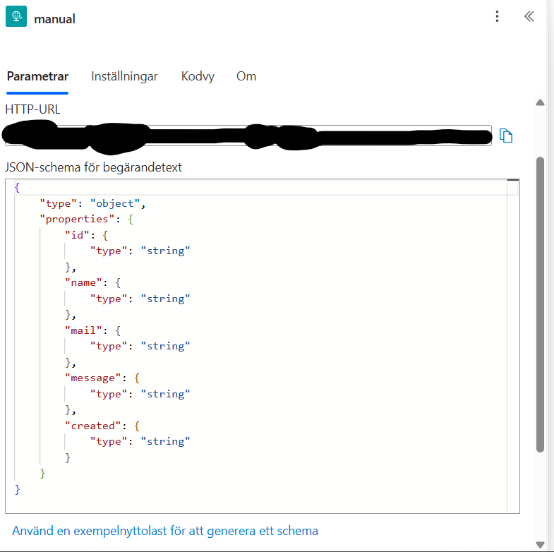
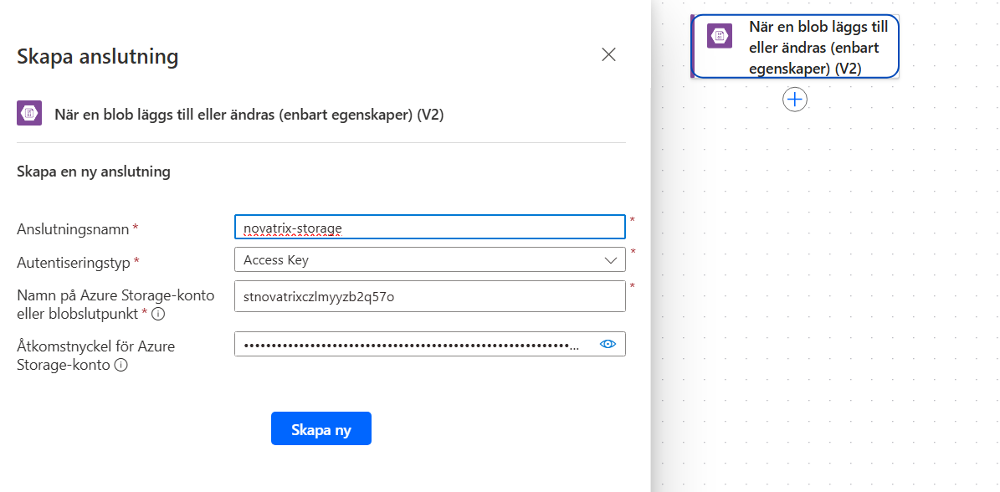
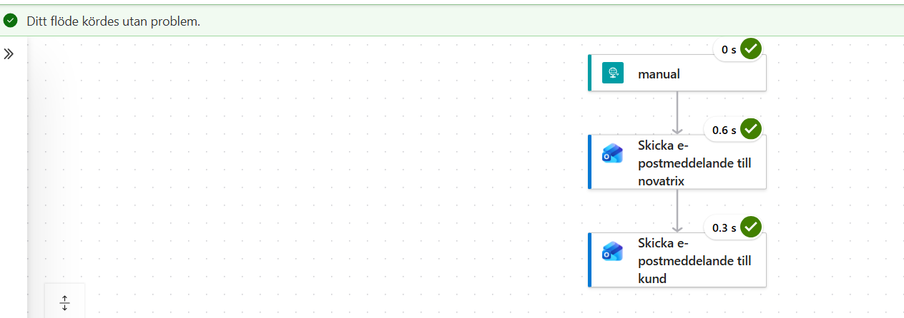
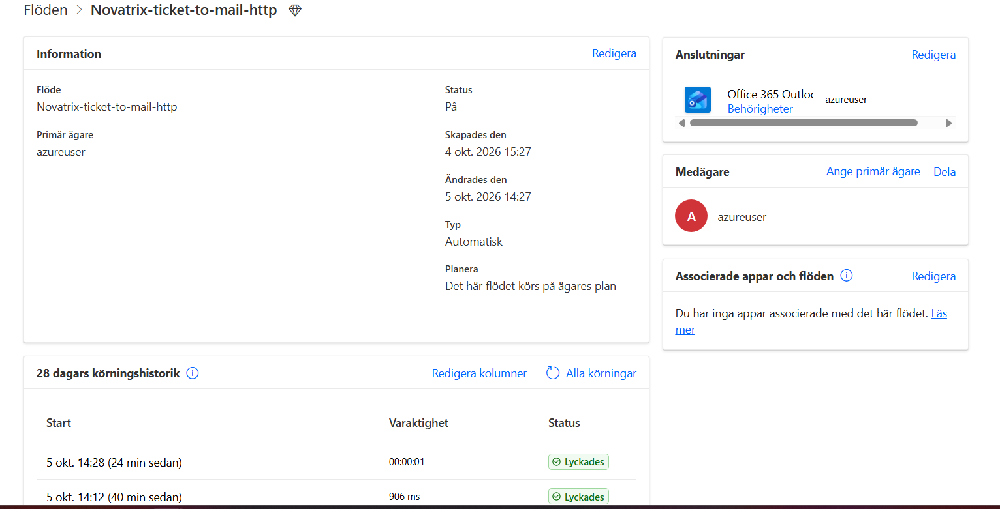
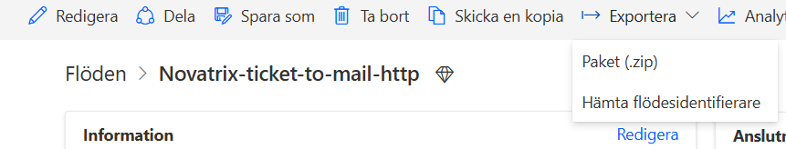

# V39 – Power Automate och Microsoft 365

**Av Felix Samuelsson**

**Kurs:** Microsoft Azure

**GitHub Repo:** https://github.com/03felsam/azure-mov25

## 1. Syfte

Syftet med uppgiften är att koppla ihop Novatrix ärendeformulär i Azure med Microsoft 365 genom Power Automate. När ett ärende skickas in ska informationen automatiskt hanteras och göras tillgänglig för kundtjänsten.

Arbetsflödet ska kunna ta emot ett nytt ärende, skapa en post i SharePoint och skicka ett mejl till kundtjänsten. På så sätt behöver personalen inte registrera varje ärende manuellt.

## 2. Val av utlösare

Det finns två alternativ för att starta ett Power Automate-flöde i den här uppgiften:

- **Blob-trigger:** Flödet startar när en ny blob skapas i en vald container i ett Azure Storage account.
- **HTTP-trigger:** Flödet startar när våran app skickar en HTTP-förfrågan med ärendets information i JSON-format.

Dessa valen integreras i våran Cloud-init fil genom våran ärende app för att kunna koppla azure med microsoft 365.

### 2.1 Alternativ: Blob-trigger

 Blob-triggern användas för att reagera när nya filer skapas i en vald  storage container. För att använda Blob trigger behöver flödet anslutas till rätt Storage Account och container genom ett kommando. Applikationen måste också spara ärendena på ett sätt som triggern kan upptäcka. Därför behöver vi ändra våran cloud innit konfiguration innan vi kan börja med denna. Vi har två val Root och Folder. BLob trigger fungerar bara på Root.

För att kunna länka power automate och azure med det specifika containern behöver vi en nyckel vilket du kan få med detta kommando:
````
az storage account keys list -g DIN-RESOURCEGRUPP -n DITTSTORAGEACCOUTNAME --query" [0].value" -o tsv  
````
**Varning:** En Storage Account-nyckel ger omfattande åtkomst till lagringen. Den ska inte publiceras i GitHub, skärmbilder eller dokumentation. 

Därefter går vi in och skapar en ny anslutning för att kunna fixa våran blob storage.



### 2.2 HTTP-trigger

Jag skapade ett Power Automate-flöde med utlösaren **When an HTTP request is received**.

För att konfigurera triggern behövs följande:


1. Ett JSON-schema som Power Automate använder för att tolka inkommande data.
2. En konfiguration som bestämmer vem eller vad som får anropa flödet.


I följande bild ser vi inte konfigurationen för vem eller vad som får anropa vårat HTTP 


Exemplet visar strukturen på informationen som kan skickas från formuläret. Fälten måste stämma överens med den data som applikationen faktiskt skickar.

När flödet sparas genereras en HTTP-URL. Den används av Azure-applikationen för att skicka ärendeinformationen till Power Automate.

**Viktigt:** HTTP-URL:en kan innehålla information som gör det möjligt att anropa flödet. Den ska därför behandlas som en hemlighet och inte läggas i ett publikt GitHub-repo.

## 3. Koppling till Azure-applikationen

För att koppla ihop flödet med formuläret lade jag in anropet till Power Automate i applikationens konfiguration via `cloud-init`.
När användaren skickar in formuläret skickar applikationen en HTTP POST-förfrågan med ärendets information i JSON-format.

Principen för anropet kan testas med ett `curl` kommando:

```bash
curl -X POST "DIN_HTTP_TRIGGER_URL" \
  -H "Content-Type: application/json" \
  -d 'ETT JSON EXEMPEL'
```

Byt ut `DIN_HTTP_TRIGGER_URL` mot den faktiska URL:en och anpassa JSON-fälten till flödets schema.

I den färdiga kedjan ska ett inskickat formulär automatiskt skicka informationen vidare. Användaren ska inte behöva öppna Power Automate eller SharePoint manuellt.

## 4. Integration med Microsoft 365

Efter att ärendet har registrerats använder flödet åtgärden **Send an email (V2)** i Outlook för att skicka en notis till kundtjänsten.

Mejlet innehåller:

- Ärendets ID.
- Namn.
- Email.
- Vilken tid ärendet skapades.
- EN beskrivning av problemet.

Genom att använda dynamiskt innehåll från HTTP-triggern kan mejlet fyllas med information från det aktuella inskickade ärendet.

Flödets huvudsakliga ordning är:

1. HTTP-triggern tar emot ett nytt ärende.
2. Power Automate tolkar JSON-informationen.
3 . Ett mejl skickas till kundtjänsten.





## 5. Export och versionshantering

Power Automate-flödet kan exporteras som ett ZIP-paket för att underlätta säkerhetskopiering och eventuell import i en annan miljö.

Vid export ska man kontrollera att anslutningar och miljöberoenden hanteras korrekt. En exporterad flödesdefinition innebär inte automatiskt att alla anslutningar fungerar efter import.

Jag undersökte även exportalternativen och hur flödets definition kan granskas. Jag fick problem med Dataverse i min standardmiljö och använder därför inte Dataverse som en nödvändig del av lösningen.

Konfigurationen versionshanteras i GitHub. Hemligheter, privata nycklar, Storage Account-nycklar och den fullständiga HTTP-trigger-URL:en ska inte läggas i repot.




