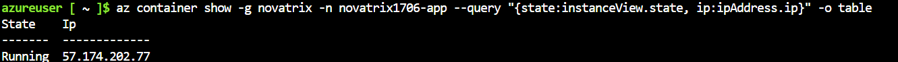
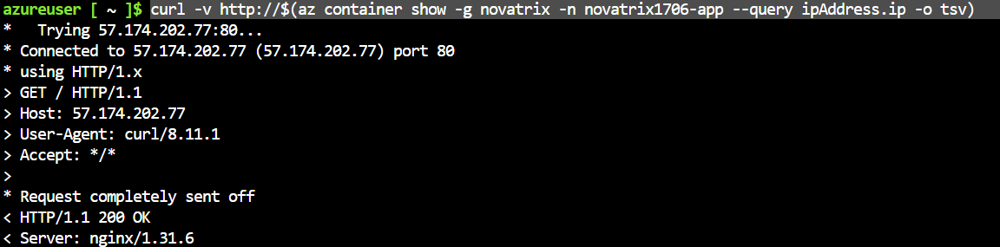

# V40 – Alternativ virtualiseringsnivå för Novatrix

**Av Felix Samuelsson**

**Kurs:** Microsoft Azure

**GitHub Repo:** https://github.com/03felsam/azure-mov25

## 1. Mål

Målet med uppgiften är att köra en del av novatrix's kundtjänst på en alternativ virtualiseringsnivå och jämföra den med en virtuell maskin.

Det finns två alternativ att jobba med:

- **Azure Container Instances (ACI):** Kör en container med en webbapplikation som använder Nginx.
- **Azure Functions:** Tar emot HTTP-anrop och returnerar ett svar när funktionen anropas.

Det ska även finnas en förklara hur VM, containers och serverless fungerar, vad skillnaderna är samt vilken lösning som passar bäst för novatrix ärendemottagning.

I denna guide kommer jag bara att förklara hur man sätter upp en container app men diskussionen angående serverless, vm och container kommer att användas.
## 2. Containerlösning med Azure Container Instances

### 2.1 Dockerfile

En dockerfile används för att paketera en enkel webbapplikation med Nginx. Dockerfilen utgår från Nginx Alpine och kopierar in `index.html` till den katalog som Nginx använder för statiska webbsidor och ser ut sähär:

```dockerfile
FROM nginx:alpine

COPY index.html /usr/share/nginx/html/index.html

EXPOSE 80
```

Detta gör det möjligt att paketera webbplatsen i en container och köra den i Azure Container Instances utan att behöva konfigurera en hel virtuell maskin.

### 2.2 Förberedelser i Azure

Först behöver resursgruppen finnas. Jag använder resursgruppen `novatrix` i regionen `swedencentral`.

```bash
az group create --name novatrix --location swedencentral
```

Därefter registrerar jag de resursleverantörer som kommer att användas för denna guide. DEtta behövs göras en gång per premuration.

```bash
az provider register --namespace Microsoft.ContainerRegistry
```

```bash
az provider register --namespace Microsoft.ContainerInstance
```

```bash
az provider register --namespace Microsoft.Web
```

```bash
az provider register --namespace Microsoft.Storage
```

```bash
az provider register --namespace microsoft.insights
```

### 2.3 Skapa Azure Container Registry

Azure Container Registry (ACR) används för att lagra containerns image. När våran image har byggts kan Azure Container Instances hämta den från registret.

```bash
az acr create --resource-group novatrix --name novatrixacr1706 --sku Basic
```

Därefter browsar jag till mappen där Dockerfile finns och bygger sedan imagen i Azure Container Registry:

```bash
az acr build --registry novatrixacr1706 --image novatrix-app:v1 .
```

För att kontrollera att imagen finns i registret använder jag:

```bash
az acr repository list --name novatrixacr1706 --output table
```

Om administratörskontot används (och inte managed identity) aktiveras det med följande kommando:

```bash
az acr update --name novatrixacr1706 --admin-enabled true
```

Administratörsuppgifter hämtas sedan med:

```bash
az acr credential show --name novatrixacr1706
```

Dessa adminuppgifter är en säkerhetsbrist och bör hållas hämliga och inte publishade på github.

### 2.4 Köra containern

När våran image finns i registret kan den köras som en container i Azure Container Instances och på så sätt hosta våran webbapp. Anledningen till detta behövs innan vi kan skapa våran container är på grund av att en image fungerar som en mall på våran app medans en container är en körande instans av denna app.

```bash
az container create --resource-group novatrix --name novatrix1706-app --image novatrixacr1706.azurecr.io/novatrix-app:v1 --os-type Linux --cpu 1 --memory 1 --ports 80 --dns-name-label novatrix1706-app --registry-username novatrixacr1706 --registry-password "ANVÄND DITT REGISTER PASSWORD"
```

Kommandot skapar en container med Linux, en CPU, 1 GB minne och port 80. Det anger också vilken container image som ska användas och vilka autentiseringsuppgifter som används för att hämta den från registret.

För att kontrollera containerns tillstånd och IP-adress används följande:

```bash
az container show -g novatrix -n novatrix1706-app --query "{state:instanceView.state, ip:ipAddress.ip}" -o table
```


Jag kan också kontrollera om webbservern svarar med ett curl commando som kommer returna 200 om det fungerar:

```bash
curl -v http://$(az container show -g novatrix -n novatrix1706-app --query ipAddress.ip -o tsv)
```


## 3. Verifiering

###  Testa containern

För containerlösningen kontrollerar jag att våran image finns i Azure Container Registry, att containern körs och att webbservern svarar.

Det görs genom att kontrollera containerns tillstånd och testa webbserverns HTTP-svar med kommandona i avsnitt 2.4.

## 4. Jämförelse av virtualiseringsnivåer

### 4.1 Virtuell maskin (VM)

En virtuell maskin emulerar en dator med ett eget operativsystem. Jag ansvarar för operativsystemet, uppdateringar, installation av programvara, konfiguration och drift av applikationen.

**Fördelar:**
- Stor kontroll över operativsystem och miljö.
- Kan köra flera komponenter och tjänster.
- Passar applikationer som kräver särskild systemkonfiguration.

**Nackdelar:**
- Kräver mer administration och underhåll.
- Beräkningsresurser kan kosta även när belastningen är låg.
- Skalning och redundans kräver mer konfiguration.

För Novatrix passar en VM om kundtjänstapplikationen behöver en egen servermiljö eller särskild konfiguration.

### 4.2 Containers

En container paketerar applikationen och dess beroenden i en avbildning. Containern delar värdsystemets operativsystemkärna, till skillnad från en VM som har ett eget operativsystem.

Med Azure Container Instances kan en container köras utan att jag behöver administrera en hel virtuell maskin.

**Fördelar:**
- Snabbare och mer konsekvent distribution.
- Applikationen kan flyttas mellan kompatibla miljöer.
- Mindre operativsystemadministration än med en VM.
- Passar webbkomponenter och tjänster som kan paketeras i en container.

**Nackdelar:**
- Applikationen måste paketeras och byggas som en containeravbildning.
- Lagring, nätverk och autentisering behöver fortfarande konfigureras.
- En container innebär inte automatiskt hög tillgänglighet eller automatisk skalning.

För Novatrix kan containers passa en avgränsad webbdel av kundtjänsten som ska distribueras på ett repeterbart sätt.

### 4.3 Serverless

Serverless innebär att molnplattformen hanterar den underliggande infrastrukturen. Med Azure Functions körs kod när en trigger aktiveras, exempelvis när ett HTTP-anrop kommer in.

**Fördelar:**
- Mindre ansvar för serverdrift.
- Passar händelsestyrda funktioner och kortare arbetsuppgifter.
- En förbrukningsplan kan anpassa resurserna efter användningen.

**Nackdelar:**
- Kallstarter kan ge fördröjning när en funktion startar efter att ha varit inaktiv.
- Körmiljön och exekveringsmodellen har begränsningar.
- Integrationer, autentisering och beständig lagring måste fortfarande byggas och konfigureras.

För Novatrix kan Azure Functions passa mottagningen av ett ärende via HTTP, särskilt om belastningen varierar mycket. Funktionen behöver dock kompletteras med logik som sparar eller skickar vidare ärendet.

### 4.4 Sammanfattande jämförelse

| Egenskap | VM | Container | Serverless |
|---|---|---|---|
| Infrastruktur | Jag hanterar operativsystemet | Plattformen hanterar containerinfrastrukturen | Azure hanterar den underliggande infrastrukturen |
| Kontroll | Hög | Medelhög | Lägre kontroll över körmiljön |
| Drift | Mer administration | Bygg, publicering och containerkonfiguration | Fokus på funktionens kod och integrationer |
| Skalning | Kräver konfiguration | Beror på vald containertjänst | Kan hanteras av tjänsten enligt plan och konfiguration |
| Kostnad | Kan uppstå även vid låg belastning | Beror på vald tjänst och hur länge resurser körs | Kan följa faktisk användning i en förbrukningsplan |
| Passar bäst för | Applikationer med behov av egen servermiljö | Paketerade applikationer och tjänster | Händelsestyrd logik, exempelvis HTTP-mottagning |

## 5. Val av lösning för Novatrix

Novatrix har normalt en relativt låg belastning, men kan få många ärenden under en driftstörning. Därför är det viktigt att väga kostnad, skalning och drift mot varandra.

En VM ger stor kontroll men kräver mer underhåll. En container gör det enklare att paketera och distribuera en applikation på ett konsekvent sätt. Azure Functions är särskilt intressant för en avgränsad mottagningsfunktion som bara behöver köras när ett ärende skickas in.

För själva ärendemottagningen skulle jag därför välja Azure Functions som ett möjligt alternativ när funktionen ska ta emot HTTP-anrop och skicka ärendet vidare till lagring eller Power Automate. Containerlösningen är samtidigt ett användbart alternativ för att köra en separat webbkomponent.

Det är viktigt att skilja på att ta emot ett ärende och att faktiskt behandla det. Ett HTTP-svar från en funktion visar att anropet har besvarats, men för att hela kundtjänstflödet ska fungera behöver ärendet också sparas och skickas vidare.

## 6. Slutsats

I den här uppgiften har jag dokumenterat två alternativa sätt att köra delar av Novatrix kundtjänst i Azure: containers med Azure Container Instances och en HTTP-trigger med Azure Functions.

Lösningarna illustrerar olika nivåer av abstraktion. En VM ger mest kontroll över servermiljön, containers paketerar applikationen i en portabel avbildning och serverless gör det möjligt att köra kod utifrån händelser utan att själv hantera en server.

För Novatrix beror valet på vilken del av systemet som ska köras, hur belastningen varierar och hur mycket driftansvar man vill ha. Azure Functions kan passa själva mottagningen av ärenden, medan en container kan passa en separat webbkomponent.

För att färdigställa uppgiften ska jag säkerställa att testerna visar att de alternativa lösningarna fungerar och att dokumentationen innehåller skärmbilder från verifieringen.


# V41 – 

**Av Felix Samuelsson**

**Kurs: Microsoft Azure**

GitHub Repo: [https://github.com/03felsam/azure-mov25](https://github.com/03felsam/azure-mov25)
## Mål
- Kör appen på minst en alternativ nivå
- Förklara vm, containers, serverless och skillnaderna 
- Vilar på förklaring det är den som bedöms.

Bindings kopplar data  in och ut <br/>
Cold start<br/>
Kostnad skalning och drift skillnader <br/>
Motivera valet efter novatrix's behov <br/>

## Dockerfile

FROM nginx:alpine

COPY index.html /usr/share/nginx/html/index.html

EXPOSE 80

## Prepp innan start
Resursgruppen måste finnas. Skapa den först (alla kommandon pekar på den) 
az group create --name rg-novatrix --location swedencentral

Registrera allt registrary som vi behöver. (En gång per premuration)

````
az provider register --namespace Microsoft.ContainerRegistry
````
````
az provider register --namespace Microsoft.ContainerInstance
````
````
az provider register --namespace Microsoft.Web
````
````
az provider register --namespace Microsoft.Storage
````
````
az provider register --namespace microsoft.insights
````
Slå på admin-konto (om ni inte vill använda hanterad identitet)
````
az acr update --name novatrixacr --admin-enabled true
````
````
Hämta lösenord för admin-kontot
az acr credential show --name novatrixacr
````

 ## Enligt video checka loggar och etc


az acr repository list --name novatrixacr --output table

az acr credential show --name novatrixacr

**kan byta fqnd till ip** <br/>
az container show --resource-group rg-novatrix --name novatrix-app --query ipAdress.fqdn -o tsv


**för loggar** <br/>
az container longs --resource-group rg-novatrix --name novatrix-app


## skapa function app

Hämta lösenord för admin-kontot
````
az acr credential show --name novatrixacr1706
````
````
az acr create --name novatrixacr --sku Basic
````
Skapa containern (byt ut den fetstilta texten mot era egna värden)
```` 
az container create --resource-group novatrix --name novatrix1706-app --image novatrixacr1706.azurecr.io/novatrix-app:v1 --os-type Linux --cpu 1 --memory 1 --ports 80 --dns-name-label novatrix1706-app --registry-username novatrixacr1706 --registry-password "ANVÄND DITT REGISTER PASSWORD"
````

**storage accoutn skapning** <br/>
az storage account create --resource-group rg-novatrix --name novatrixstorage --location swedencentral -sku Standard LRS

az functionapp create --resource-group rg-novatrix --name novatrix-fn --storage account stnovatrix --consumption-plan-location swedencentral --runtime node --functions-version 4 --os-type Windows

az functionapp show --resource-group rg-novatrix --name novatrix-fn -o table

Skapa upp funktioner i portalen för novatrix-fn appen **Overview -> Functions -> Create in azure portal**

Skapa en HTTP trigger som template med ett relevant namn som arende-HTTP-trigger

Där kan du lägga in javascript kod lärarens exempel 
````
module.exports = async function (context,req) (
    context.log("Novatrix arendemottagning kordes.");
    context.res = {status: 200, body: "Arende mottaget, tack"};
);
````

Du kan göra detta genom kod genom att trycka ut detta som pyton kod till din webbapp 

## Verifiering
 i http trigger vi satte upp finns det ett get function URL (Default(Function key)) där du kan kopiera en länk och pastea den i webbläsaren för att se vilket svar man får vid inlämning av ett ärende 

 Därefter kan du gå in på loggs och refresha function keyn URL och se på loggs om det fungerar.

 kan köras från terminal genom att göra:
 ````
 curl PASTE-URL-HERE 
 ```` 
 Verifiera att du får rätt svar och det fungerar!


## 
Resursgruppen måste finnas. Skapa den först (alla kommandon pekar på den) 
az group create --name rg-novatrix --location swedencentral

Registrera resursleverantörerna (en gång per prenumeration)

Skapa Register:
````
az acr create --resource-group novatrix --name novatrixacr1706 --sku Basic
````

Browsa till rätt mapp med dockerfile och kör detta.
````
az acr build --registry novatrixacr1706 --image novatrix-app:v1 .
````

Verifiera att den funkar:
````
az acr repository list --name novatrixacr1706 --output table
````

Slå på admin-konto (om ni inte vill använda hanterad identitet)
````
az acr update --name novatrixacr1706 --admin-enabled true
````


````
az container show -g novatrix -n novatrix1706-app --query "{state:instanceView.state, ip:ipAddress.ip}" -o table
````
````
curl -s -o /dev/null -w "%{http_code}\n" https://$(az container show -g novatrix -n novatrix1706-app --query ipAdress.ip -o tsv)/ 
````