# V41 – Examination,  Konfigurering av Nordvik

**Av Felix Samuelsson**

**Kurs: Microsoft Azure**

GitHub Repo: [https://github.com/03felsam/azure-mov25](https://github.com/03felsam/azure-mov25)

## Design av nordvik

För denna examination samt konfiguration av deras teoretiska miljö kommer detta första kapitel förklarar delarna som bygger upp nordvik samt valen jag har gjort för fylla nordviks krav.
Senare i denna readme kommer jag dyka in i detaljer om varje område samt hur det är uppbyggt.

## Portal jämförende
För valen av Central azure tjänst för portalen kan vi välja mellan att använda en VM, Container eller Serverless lösning. För att välja vilken typ som passar best för Nordviks miljö behöver vi göra ett flertal listor med positiva och negativa delar.

### VM

Att portalen finns på en uppsatt VM innebär att du har en hel dator som du behöver underhålla. Detta innebär mycket driftansvar samt hög flexibilitet när det gäller konfiguration. Dock innebär det även att företaget behöver ha kvalificerad personal som vet hur man tar hand om en VM och ser till att den kan underhållas under ett flertal år.

Dessutom är VM-kostnaden en konstant kostnad så länge den är uppsatt, vilket innebär att det är en kostnad som kommer att finnas även under nattetid. Detta var specifikt nämnt i budgeten där **Nordvik vill inte betala för kapacitet som står oanvänd nattetid**, vilket är en av anledningarna till att jag tror att detta är fel val när det gäller att ha en VM som host för portalen.

En annan anledning till att en VM inte skulle passa är att för att uppfylla kravet på 99,95 % uptime under kontorstid behöver vi enligt [Microsoft Learn – Availability sets overview](https://learn.microsoft.com/en-us/azure/virtual-machines/availability-set-overview) använda två VM:ar för att nå kravet. Detta skulle göra lösningen både dyrare och mer komplicerad.

Slutligen är skalningen av en VM ganska bra, men den blir mer komplicerad när flera VM:ar behöver läggas till och hanteras. Därför tycker jag att en VM blir mer arbete och kostnad än vad Nordvik behöver för denna portal.


### Container

En container innebär att portalen körs som en applikation på Azures servrar, vilket betyder att du främst behöver ha koll på själva appen medan operativsystemskärnan och den underliggande infrastrukturen hanteras av Azure.

En container bygger på en Image som berättar för systemet hur appen ska köras. Allting som behövs för att köra applikationen finns därför inbyggt i imagen och kan enkelt flyttas eller startas på nytt. Detta gör det även enkelt att skapa nya instanser av applikationen utan att behöva ändra på själva huvudversionen.

Denna applikation kan även ändra hur mycket resurser den behöver beroende på hur många som använder portalen genom att skapa repliker. Detta ökar kapaciteten under stressiga tider, exempelvis om det kommer in över 300 felanmälningar under en timme. Den kan även konfigureras så att antalet repliker minskar när trafiken är låg, vilket gör att Nordvik inte behöver betala för lika mycket oanvänd kapacitet under nattetid.

Därför tycker jag att container passar bra för Nordvik eftersom trafiken kan variera väldigt mycket under dagen.

### Serverless

Serverless fungerar på sättet att man kör kod utan att själv behöva hantera någon server. Detta görs automatiskt genom molnet och den körmiljö som molnleverantören tillhandahåller.

Serverless fungerar så att varje gång koden körs används resurser och man betalar utifrån användningen. Detta är otroligt simpelt att använda eftersom man inte behöver tänka lika mycket på servrar, operativsystem eller underhåll.

För Nordvik hade serverless därför kunnat vara ett bra alternativ eftersom trafiken varierar mycket och är i princip noll under natten. Därför kan kostnaden minska när applikationen inte används. Nackdelen är däremot att serverless passar bättre för mindre separata funktioner än för en hel webbportal. Serverless har även ännu mindre kontroll och har vissa begränsningar som göra att det kan va svårt att konfigurea portalen på sättet nordvik vill. Därför tycker jag att container passar bättre som huvudlösning för Nordviks portal, medan serverless-lösningar kan användas för vissa delar av systemet.


### Val av faktisk lösning

Även om Container Apps bedömdes vara den bästa lösningen för Nordviks varierande trafik valde jag att använda en virtuell Linux-maskin (VM) för portalen. Anledningen var att jag inte lyckades integrera applikationen korrekt i Azure Container Apps inom tidsbegränsningen. Jag valde därför slutligen att få en fungerande portal med det jag kan.

VM-lösningen ger mig god kontroll över miljön, men innebär mer driftansvar och att jag behöver hantera uppstart, avstängning och uppdateringar. Jag har därför konfigurerat automatisk avstängning nattetid och arbetat med schemalagd uppstart för att minska onödiga kostnader över nattetid. Lösningen är dessutom inte riktigt korrekt konfigurera. Eftersom för att lösa alla proble ska man sätta upp en azure load balancer och Azure avilability set med 2 VM's för tillgänglighets kravet på 99.5% av office tid och att en instans faller av. 

## Storage och säkerhet

Jag skapade ett Azure Storage Account med Blob Storage för att lagra bilder från felanmälningar och andra filer. Anonym publik åtkomst är avstängd och HTTPS krävs. VM:ens Managed Identity får åtkomst till lagringen via RBAC med rollen **Storage Blob Data Contributor**, vilket följer principen om minsta möjliga behörighet.

Bilder som används ofta passar i Hot-nivån, medan äldre dokument kan flyttas till Cold med hjälp av en livscykelregel.


## Kostnader och budget

Jag använder budgetvarningar vid cirka 2 000 kr för att upptäcka kostnadsökningar och hålla mig inom målet på 2 500 kr per månad. Resurser märks med taggar för projekt och kostnadsställe. Azure Pricing Calculator kan användas för att uppskatta kostnaderna. Automatisk avstängning av VM:en nattetid minskar driftskostnaderna, men vissa resurser kan fortfarande kosta pengar.

Allting som är gjort är dessutom taggat för övervakning samt verifiering.
 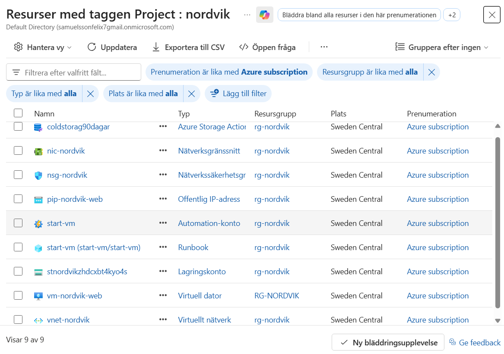

## Microsoft 365 och automatisering

Jag skapade en SharePoint-lista för felanmälningar och ett Power Automate-flöde som tar emot information från applikationen. Flödet skapar ett ärende i SharePoint och skickar e-post till relevanta mottagare. Detta förenklar hanteringen och gör det lättare att följa upp inkomna felanmälningar.

## Nätverk och åtkomst

Jag konfigurerade ett virtuellt nätverk, nätverksregler (NSG), en publik IP-adress och ett nätverkskort för VM:en. Trafik till webbplatsen tillåts via port 80 och 443, medan SSH-åtkomst via port 22 begränsas till administratörens IP-adress. För en produktionslösning behöver HTTPS vara korrekt konfigurerat.

## Infrastructure as Code

Jag använde en ARM-mall för att skapa de viktigaste Azure-resurserna, bland annat nätverk och Storage Account. VM:en skapades med Azure CLI och konfigurerades med cloud-init utifall att man ska skapa två för Azure load balancer och Availability set. Filerna lagras i GitHub för versionshantering och för att göra lösningen lättare att återskapa.


# Guide för ARM Template

## GitHub och förberedelser

För att kunna skapa Azure-miljön behöver vi först en resursgrupp där resurserna ska placeras. I det här projektet använder jag resursgruppen `rg-nordvik`.

Därefter loggar jag in på GitHub via terminalen i Visual Studio Code med följande kommando:

```bash
gh auth login
```

När inloggningen är klar klonar jag repositoryt som innehåller projektets filer:

```bash
git clone https://github.com/03felsam/azure-mov25.git
```

Gå sedan till mappen där ARM-mallen ligger vilket är i mitt fall:

```powershell
cd "azure-mov25\V41 Examination"
```

## Validering och deployment

Innan resurserna skapas kontrollerar jag att ARM-mallen är korrekt och att distributionen kommer att skapa de resurser som förväntas. Exempel på detta är ipadressen för SSH access.

Först validerar jag mallen med följande kommando:

```bash
az deployment group validate -g rg-nordvik --template-file miljoNordvik.json
```

Därefter använder jag `what-if` för att se vilka ändringar som kommer att göras i Azure. Detta gör det enklare att kontrollera vilka resurser som ska skapas eller ändras innan distributionen genomförs.

```bash
az deployment group what-if -g rg-nordvik --template-file miljoNordvik.json
```

Innan distributionen ska relevanta inställningar i ARM-mallen kontrolleras och anpassas efter den egna miljön. Det kan exempelvis handla om nätverksregler och vilken IP-adress som ska tillåtas för SSH-anslutning.

När mallen har validerats skapar jag resurserna med följande kommando:

```bash
az deployment group create -g rg-nordvik --template-file miljoNordvik.json
```

 I mitt projekt används ARM-mallen för att skapa de grundläggande resurserna, medan den virtuella maskinen skapas separat med Azure CLI. Det gör det enklare att ändra VM-inställningar och skapa fler instanser vid behov.

## Skapa VM

Skapandet av den virtuella maskinen (VM) görs separat från ARM-mallen med hjälp av Azure CLI. Detta gör det enklare att ändra inställningar och skapa flera virtuella maskiner vid behov.

Först genererar man ett SSH-nyckelpar på sin lokala dator med följande kommando i PowerShell eller Visual Studio Code-terminalen. Ändra sökvägen till den plats där nycklarna ska sparas. Mappen måste finnas innan kommandot körs.

```powershell
ssh-keygen -t rsa -b 4096 -f "C:\AzureMov25\ssh\id_rsa"
```

Kommandot skapar en privat och en publik nyckel. Den publika nyckeln (`id_rsa.pub`) används när VM:en skapas, medan den privata nyckeln används för att ansluta till maskinen. Den privata nyckeln ska hållas hemlig och inte laddas upp till GitHub.

Därefter behöver `cloud-init.txt` anpassas efter den egna miljön. Kontrollera särskilt följande inställningar:

- Storage Account-namn.
- Namnet på Blob Storage-containern.
- Om filer ska sparas direkt i containern eller i en mapp/prefix.
- URL:en till Power Automate-flödet som tar emot ärenden.

När inställningarna är klara går man till mappen där `cloud-init.txt` ligger. Därefter kan VM:en skapas med följande kommando. Anpassa storlek, sökvägar och resursnamn efter den egna miljön.

```powershell
az vm create `
  --resource-group "rg-nordvik" `
  --name "vm-nordvik-web" `
  --nics "nic-nordvik" `
  --image Ubuntu2204 `
  --size Standard_D2as_v6 `
  --admin-username azureuser `
  --ssh-key-values "C:\AzureMov25\ssh\id_rsa.pub" `
  --assign-identity `
  --custom-data "cloud-init.txt" `
  --os-disk-size-gb 30 `
  --storage-sku StandardSSD_LRS `
  --tags Project=nordvik CostCenter=IT
```

Kommandot skapar VM:en med en hanterad identitet, vilket senare används för att ge maskinen åtkomst till Blob Storage. Det förutsätter att nätverkskortet redan har skapats av ARM-mallen och att namnet stämmer.

### Ansluta till VM:en med SSH

På Windows kan man vid behov begränsa åtkomsten till den privata nyckeln med följande kommandon. Byt ut sökvägen mot den faktiska platsen för nyckeln.

```powershell
icacls "C:\AzureMov25\ssh\id_rsa" /inheritance:r
icacls "C:\AzureMov25\ssh\id_rsa" /grant:r "$($env:USERNAME):R"
```

Hämta därefter VM:ens publika IP-adress från Azure-portalen och anslut med SSH:

```powershell
ssh -i "C:\AzureMov25\ssh\id_rsa" azureuser@DIN-PUBLIKA-IP
```

### Ge VM:en åtkomst till Blob Storage

För att VM:en ska kunna ladda upp filer till Blob Storage måste dess hanterade identitet få rätt behörighet.

I Azure-portalen går man till:

**Resource Group → Storage Account → Åtkomstkontroll (IAM) → Lägg till rolltilldelning**

Tilldela rollen **Storage Blob Data Contributor** till den hanterade identiteten för `vm-nordvik-web`. Rollen ger möjlighet att läsa, skriva och ta bort blobbar. För bättre säkerhet bör behörigheten begränsas till den container som applikationen behöver använda, om det är möjligt.

Efter tilldelningen ska konfigurationen motsvara skärmbilden nedan.


## Extra tjänster

### VM-hantering

Jag valde storleken `Standard_D2as_v6` som utgångspunkt för VM:en. Den har två virtuella processorkärnor och 8 GiB RAM. Den slutliga kapaciteten behöver verifieras genom tester av belastingen, särskilt eftersom Nordvik kan ha perioder med upp till 300 anmälningar per timme under kriser. Men borde fungera bra då den rekomenderas av microsoft för standard appar. 

För att minska kostnaderna har jag konfigurerat automatisk avstängning vid midnatt. Jag har även skapat ett Azure Automation-konto med en Runbook som startar VM:en igen klockan 06.00 varje morgon.


Runbooken innehåller följande PowerShell-kod:

```powershell
$SubscriptionId = "DITT-SUBSCRIPTION-ID"

Connect-AzAccount -Identity
Set-AzContext -SubscriptionId $SubscriptionId

Start-AzVM -ResourceGroupName "rg-nordvik" -Name "vm-nordvik-web"
```

För att koden ska fungera måste Automation-kontots hanterade identitet vara aktiverad och ha rätt behörighet att starta VM:en, exempelvis rollen **Virtual Machine Contributor** vilket i detta fallet är våra **rg-nordvik** grupp.


Slutligen kopplade jag Runbooken till ett schema som startar VM:en klockan 06.00 varje morgon.


Detta minskar tiden som VM:en är igång och kan därmed minska kostnaden. Däremot innebär avstängningen att appen inte är tillgänglig under natten. 

## Storage

Jag har skapat ett Storage Account med två Blob Storage-containrar. Den ena används för bilder och filer som hör till inkomna ärenden. Den andra, `coldstorage`, är tänkt för kontrakt och andra dokument som inte behöver användas lika ofta.

Jag har även konfigurerat en livscykelregel som flyttar blobbar som är äldre än 90 dagar till **Cold-nivån**. Regeln hjälper till att minska lagringskostnaderna för filer som sällan används.

Cold är en lagringsnivå för data som fortfarande behöver vara tillgänglig online, men som används mer sällan än data i Hot-nivån. Archive är ett billigare alternativ för långtidslagring, men kräver att data återställs innan den kan läsas igen.

Det är viktigt att livscykelregeln bara omfattar de filer som ska flyttas till Cold. Därför bör regeln begränsas till rätt container eller prefix, så att aktiva ärendebilder inte flyttas av misstag. Azure utvärderar livscykelregler automatiskt, så flytten behöver inte ske exakt på den dag då en fil blir 90 dagar gammal.


## Power Automate

För att koppla samman Azure-applikationen med Microsoft 365 har jag lagt in en HTTP-anropsadress till ett Power Automate-flöde i `cloud-init.txt`. Adressen konfigureras när VM:en skapas och används av applikationen när ett nytt ärende skickas in.

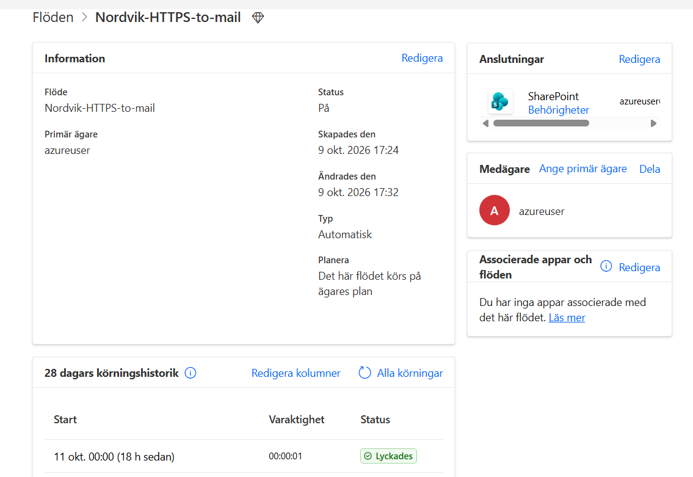

Flödet tar emot informationen från applikationen, skapar ett nytt objekt i en SharePoint-lista på vår kommunikationswebbplats och skickar ett e-postmeddelande till en delad brevlåda för administratörer. På så sätt kan personalen ta emot och följa upp ärenden utan att behöva kontrollera applikationen manuellt.

För versionshantering har jag exporterat flödet som en ZIP-fil och sparat dess definition i JSON-format. Det gör det enklare att dokumentera flödet och återskapa det vid behov.

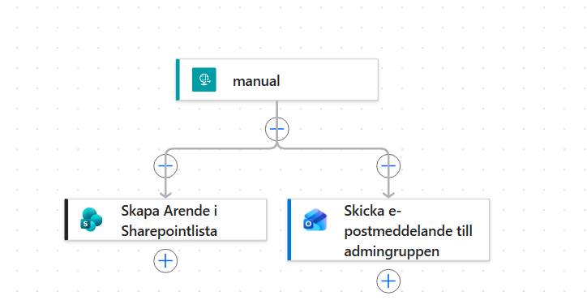

## SharePoint

Jag har skapat en SharePoint Communication Site som bara en behörig grupp har åtkomst till. På webbplatsen finns en lista över felanmälningar. När en användare skickar in ett ärende via applikationen skapas en ny post i listan med information om ärendet.

Bilden lagras separat i Blob Storage i stället för direkt i SharePoint-listan. Detta skiljer ärendeinformationen från filhanteringen och gör det möjligt att hantera bilderna i Azure Storage.

Behörigheterna i SharePoint begränsas ArendeHanterare för att garantera säkerhet angående personuppgifter.

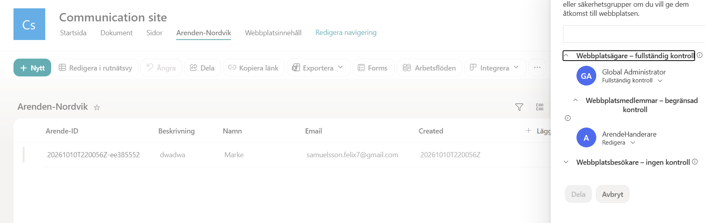

## Nätverk och säkerhet

VM:en använder ett virtuellt nätverk, ett nätverkskort och en publik IP-adress. Nätverkstrafiken styrs med en Network Security Group (NSG). Webbtrafik tillåts via port 80 och 443, medan SSH via port 22 begränsas till administratörens IP-adress. I produktion bör denna regel ändras till kontorets privata nätverk för att garantera att flera kan jobba mot dator samtidigt och det inte är begränsat till en administratörs dator.

Här är våra säkerhetsinställningar vilket löser de grundläggande nätverksproblemen.

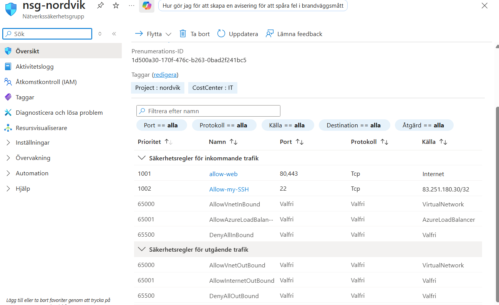

Storage Account är konfigurerat för att kräva HTTPS och anonym publik åtkomst till blobbar är avstängd. VM:en använder sin hanterade identitet för att få åtkomst till lagringen i stället för att lagra inloggningsuppgifter i applikationen.

Slutligen har även storagekontot begränsad access med bara Admingruppen som har tillgång våran arende kontainer.
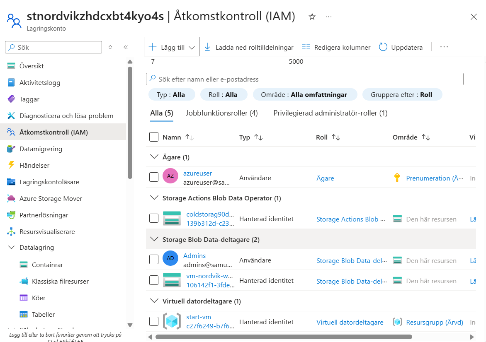

## Kostnader

Jag använde Azure Pricing Calculator faör att uppskatta kostnaderna för virtuella maskiner, Storage Account, virtuellt nätverk och IP-adresser. Beräkningen gav en uppskattning på cirka **1 130 kr per månad** för de resurser som ingick i kalkylen.

Det ger utrymme inom budgetmålet på 2 500 kr per månad, men kostnaden beror på faktisk användning, region, lagringsmängd och trafik. Automatisk avstängning kan minska kostnaden för VM-beräkning, men exempelvis diskar och vissa andra resurser kan fortfarande kosta pengar när VM:en är avstängd.

Beräkningen omfattar inte nödvändigtvis Power Automate Premium eller eventuella extra Microsoft 365-licenser. Dessa behöver kontrolleras separat för att få en fullständig kostnadsbild.

[Azure Pricing Calculator – min beräkning](https://azure.com/e/10ff0fd46a8d4abbacd04b9fe44c7856)

## Geomgång att allting fungerar
Slutligen har  vi ett serie med screenshots som följer ärendet hela vägen.

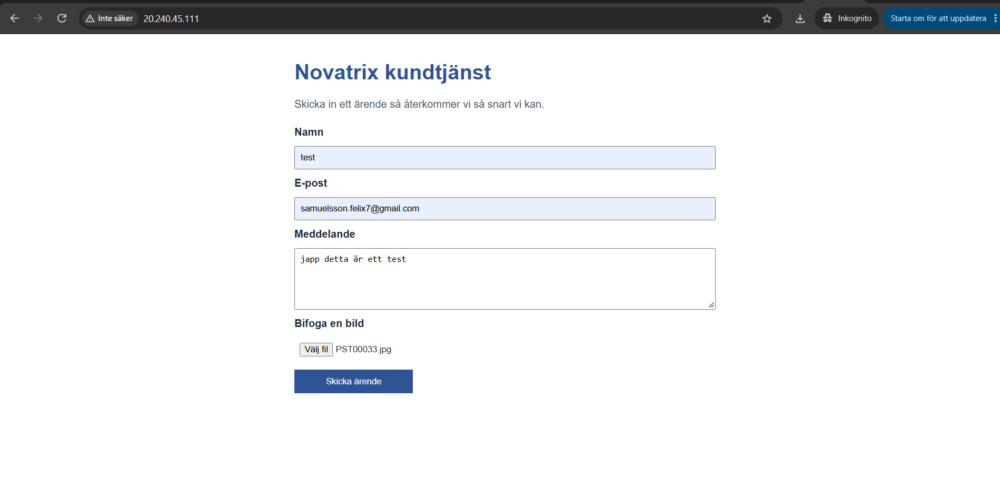

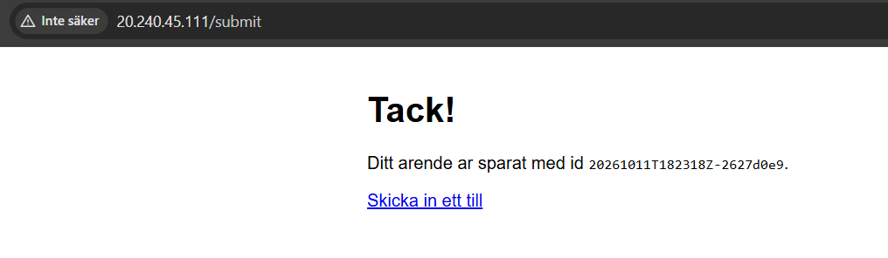

Vårat ärende nummer 20261011T182318Z-2627d0e9 för verifiering.

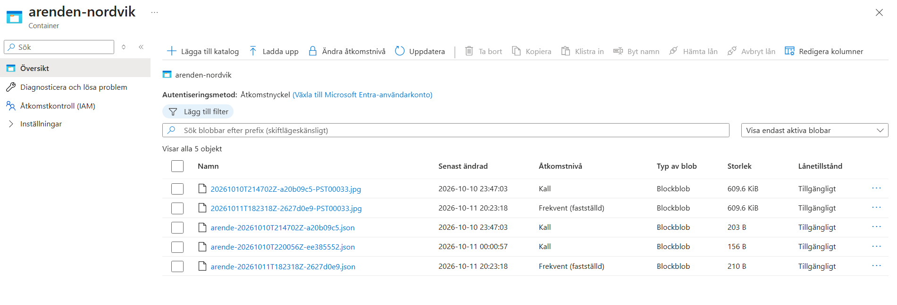

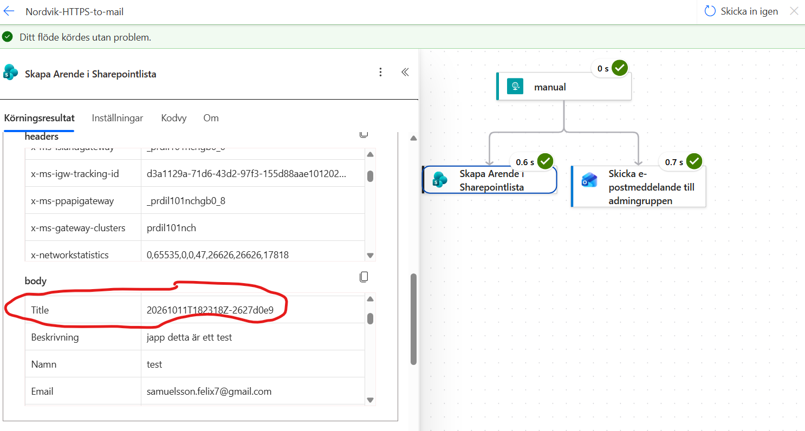

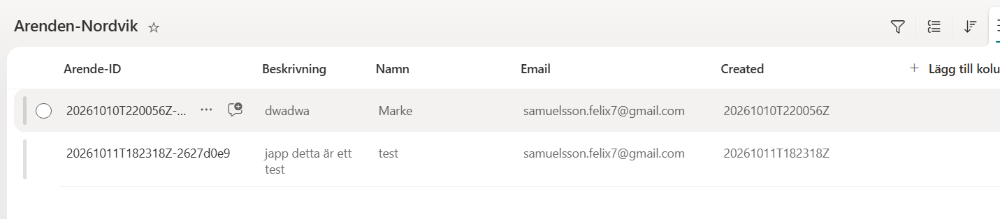

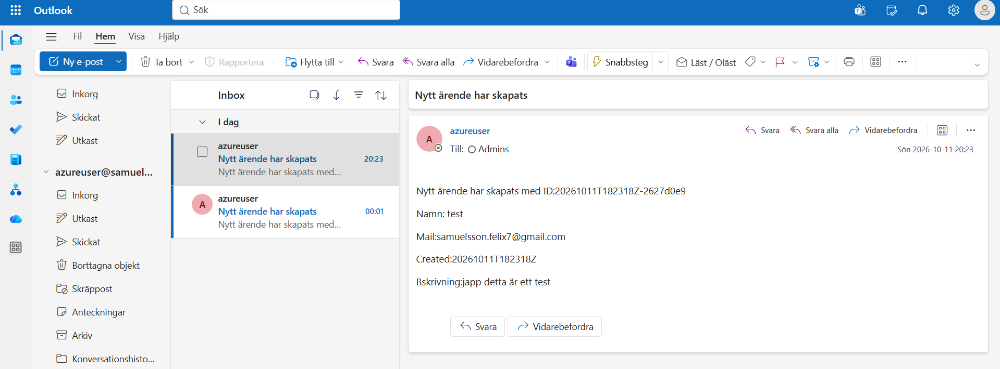