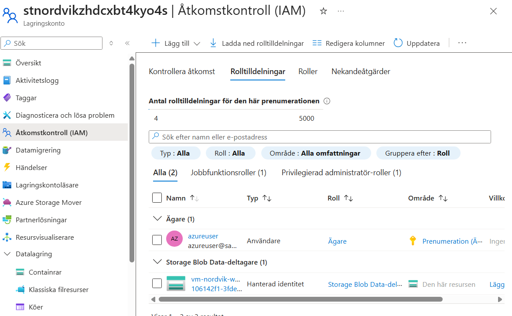
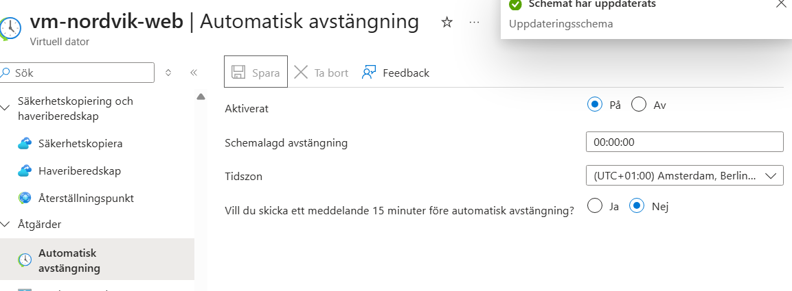
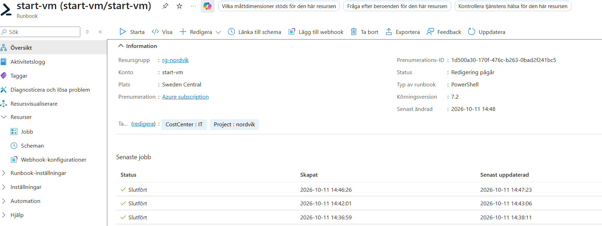
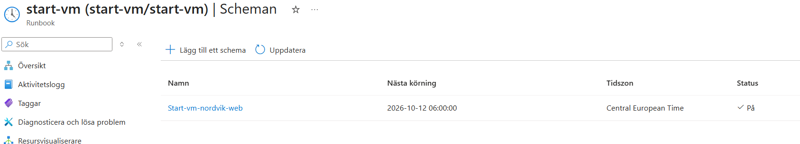
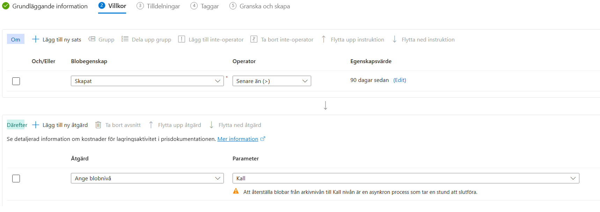
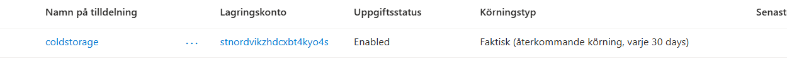

# V41 – Examination,  Konfigurering av Nordvik

**Av Felix Samuelsson**

**Kurs: Microsoft Azure**

GitHub Repo: [https://github.com/03felsam/azure-mov25](https://github.com/03felsam/azure-mov25)

## Design av nordvik

För denna examination samt konfiguration av deras teoretiska miljö kommer detta första kapitel förklarar delarna som bygger upp nordvik samt valen jag har gjort för fylla nordviks krav.
Senare i denna readme kommer jag dyka in i detaljer om varje område samt hur det är uppbyggt.

## Portal jämförende
För valen av Central azure tjänst för portalen kan vi välja mellan att använda en VM, Container eller Serverless lösning. För att välja vilken typ som passar best för Nordviks miljö behöver vi göra ett flertal listor med positiva och negativa delar.

### VM

Att portalen finns på en uppsatt VM innebär att du har en hel dator som du behöver underhålla. Detta innebär mycket driftansvar samt hög flexibilitet när det gäller konfiguration. Dock innebär det även att företaget behöver ha kvalificerad personal som vet hur man tar hand om en VM och ser till att den kan underhållas under ett flertal år.

Dessutom är VM-kostnaden en konstant kostnad så länge den är uppsatt, vilket innebär att det är en kostnad som kommer att finnas även under nattetid. Detta var specifikt nämnt i budgeten där **Nordvik vill inte betala för kapacitet som står oanvänd nattetid**, vilket är en av anledningarna till att jag tror att detta är fel val när det gäller att ha en VM som host för portalen.

En annan anledning till att en VM inte skulle passa är att för att uppfylla kravet på 99,95 % uptime under kontorstid behöver vi enligt [Microsoft Learn – Availability sets overview](https://learn.microsoft.com/en-us/azure/virtual-machines/availability-set-overview) använda två VM:ar för att nå kravet. Detta skulle göra lösningen både dyrare och mer komplicerad.

Slutligen är skalningen av en VM ganska bra, men den blir mer komplicerad när flera VM:ar behöver läggas till och hanteras. Därför tycker jag att en VM blir mer arbete och kostnad än vad Nordvik behöver för denna portal.


### Container

En container innebär att portalen körs som en applikation på Azures servrar, vilket betyder att du främst behöver ha koll på själva appen medan operativsystemskärnan och den underliggande infrastrukturen hanteras av Azure.

En container bygger på en Image som berättar för systemet hur appen ska köras. Allting som behövs för att köra applikationen finns därför inbyggt i imagen och kan enkelt flyttas eller startas på nytt. Detta gör det även enkelt att skapa nya instanser av applikationen utan att behöva ändra på själva huvudversionen.

Denna applikation kan även ändra hur mycket resurser den behöver beroende på hur många som använder portalen genom att skapa repliker. Detta ökar kapaciteten under stressiga tider, exempelvis om det kommer in över 300 felanmälningar under en timme. Den kan även konfigureras så att antalet repliker minskar när trafiken är låg, vilket gör att Nordvik inte behöver betala för lika mycket oanvänd kapacitet under nattetid.

Därför tycker jag att container passar bra för Nordvik eftersom trafiken kan variera väldigt mycket under dagen.

### Serverless

Serverless fungerar på sättet att man kör kod utan att själv behöva hantera någon server. Detta görs automatiskt genom molnet och den körmiljö som molnleverantören tillhandahåller.

Serverless fungerar så att varje gång koden körs används resurser och man betalar utifrån användningen. Detta är otroligt simpelt att använda eftersom man inte behöver tänka lika mycket på servrar, operativsystem eller underhåll.

För Nordvik hade serverless därför kunnat vara ett bra alternativ eftersom trafiken varierar mycket och är i princip noll under natten. Därför kan kostnaden minska när applikationen inte används. Nackdelen är däremot att serverless passar bättre för mindre separata funktioner än för en hel webbportal. Serverless har även ännu mindre kontroll och har vissa begränsningar som göra att det kan va svårt att konfigurea portalen på sättet nordvik vill. Därför tycker jag att container passar bättre som huvudlösning för Nordviks portal, medan serverless-lösningar kan användas för vissa delar av systemet.


### Val av faktisk lösning

Även om Container Apps bedömdes vara den bästa lösningen för Nordviks varierande trafik valde jag att använda en virtuell Linux-maskin (VM) för portalen. Anledningen var att jag inte lyckades integrera applikationen korrekt i Azure Container Apps inom tidsbegränsningen. Jag valde därför slutligen att få en fungerande portal med det jag kan.

VM-lösningen ger mig god kontroll över miljön, men innebär mer driftansvar och att jag behöver hantera uppstart, avstängning och uppdateringar. Jag har därför konfigurerat automatisk avstängning nattetid och arbetat med schemalagd uppstart för att minska onödiga kostnader över nattetid. Lösningen är dessutom inte riktigt korrekt konfigurera. Eftersom för att lösa alla proble ska man sätta upp en azure load balancer och Azure avilability set med 2 VM's för tillgänglighets kravet på 99.5% av office tid och att en instans faller av. 

## Storage och säkerhet

Jag skapade ett Azure Storage Account med Blob Storage för att lagra bilder från felanmälningar och andra filer. Anonym publik åtkomst är avstängd och HTTPS krävs. VM:ens Managed Identity får åtkomst till lagringen via RBAC med rollen **Storage Blob Data Contributor**, vilket följer principen om minsta möjliga behörighet.

Bilder som används ofta passar i Hot-nivån, medan äldre dokument kan flyttas till Cold med hjälp av en livscykelregel.


## Kostnader och budget

Jag använder budgetvarningar vid cirka 2 000 kr för att upptäcka kostnadsökningar och hålla mig inom målet på 2 500 kr per månad. Resurser märks med taggar för projekt och kostnadsställe. Azure Pricing Calculator kan användas för att uppskatta kostnaderna. Automatisk avstängning av VM:en nattetid minskar driftskostnaderna, men vissa resurser kan fortfarande kosta pengar.

## Microsoft 365 och automatisering

Jag skapade en SharePoint-lista för felanmälningar och ett Power Automate-flöde som tar emot information från applikationen. Flödet skapar ett ärende i SharePoint och skickar e-post till relevanta mottagare. Detta förenklar hanteringen och gör det lättare att följa upp inkomna felanmälningar.

## Nätverk och åtkomst

Jag konfigurerade ett virtuellt nätverk, nätverksregler (NSG), en publik IP-adress och ett nätverkskort för VM:en. Trafik till webbplatsen tillåts via port 80 och 443, medan SSH-åtkomst via port 22 begränsas till administratörens IP-adress. För en produktionslösning behöver HTTPS vara korrekt konfigurerat.

## Infrastructure as Code

Jag använde en ARM-mall för att skapa de viktigaste Azure-resurserna, bland annat nätverk och Storage Account. VM:en skapades med Azure CLI och konfigurerades med cloud-init utifall att man ska skapa två för Azure load balancer och Availability set. Filerna lagras i GitHub för versionshantering och för att göra lösningen lättare att återskapa.


# Guide för ARM template
### Github
Skapa först rg-nordvik resursgrupp <br/>

Först loggar jag in med GitHub:

```bash
gh auth login
```

Sedan klonar jag repositoryt:

```bash
git clone https://github.com/03felsam/azure-mov25.git
```

Går sedan in i repositoryt:

```bash
cd azure-mov25\V41 Examination
```

## Validering och deployment

````
az deployment group validate -g rg-nordvik --template-file miljoNordvik.json
````
````
az deployment group what-if -g rg-nordvik --template-file miljoNordvik.json
````

````
az deployment group create -g rg-nordvik --template-file miljoNordvik.json
````


## Skapa VM

run i powershell på din dator med din valfria sökväg

````
ssh-keygen -t rsa -b 4096 -f C:\AzureMov25\ssh\ssh\id_rsa
````
generates it depending on where you save it
on home pc in terminal otherwise on your user in azure

Använd public key för SSH 
browsa till mappen rä du har cloudinnitfilen sparad och kör denna med ssh sökvägen som pekar mot din public SSHkey
och ändra size för valfri 
PLUS ÄNDRA I CLOUD INNIT FILEN 
HTTP UTL, ROOT, STORAGENAME OCH CONTAINER NAME
````
az vm create `
>>   --resource-group "rg-nordvik" `
>>   --name "vm-nordvik-web" `
>>   --nics "nic-nordvik" `
>>   --image Ubuntu2204 `
>>   --size Standard_F1als_v7 `
>>   --admin-username azureuser `
>>   --ssh-key-values "C:\AzureMov25\ssh\id_rsa.pub" `
>>   --assign-identity `
>>   --custom-data cloud-init.txt `
>>   --os-disk-size-gb 30 `
>>   --storage-sku StandardSSD_LRS `
>>   --tags Project=nordvik CostCenter:IT
````

Använd sedan standard på din PRIVATE key inte public
icacls .\din-nyckel.pem /inheritance:r

icacls .\din-nyckel.pem /grant:r "$($env:USERNAME):R"

ssh -i din-nyckel-pem azureuser@DUN-PUBLIKA-IP

för att ta bort kopplingen mellan SSH om du återanvänder nyckeln
 ssh-keygen -R DATORNSPUBLIKA IP

Gå sedan denna vägen för att lägga till blob access för din VM 

**rg-nordvik -> stnordvikxxxxx -> Åtkomstkontroll(IAM) -> Rolltilldelningar -> Lägg till rolltilldelning**

Därefter lägg till rollen **Storage Blob Data-deltagare** på den hanterade identiteten för **vm-novatrix-web**

slutligen ska det se ut såhär.


# Extra tjänster

## VM hantering

Valet för vilken storlek våran VM ska ha är standard_d2as_v6 vilket kostar run 70 euro per månad.

skapade automatisk avstängning av VM på mitten av natten.





````
$SubsciptionId = "DIN ID"

Connect-AzAccount -Identity

Set-AzContext -SubscriptionId $SubsciptionId

Start-AzVM -ResourceGroupName "rg-nordvik" -Name "vm-nordvik-web"
````


## Storage


 Skapade en tilldelning som körs varje 30 dagar och appliceras på alla blobar i storage accountet och automatiskt stoppar allting i cold storage.

 


 ## Power automate

 ## Sharepoint

